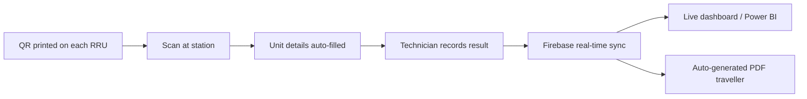

# Digital Traveller System: QR-based Repair Tracking for Nokia
 
### ***Replacing the paper traveller sheet with one QR scan.***
Every telecom unit that comes in for repair is **scanned at each station**, **updated digitally** and **synced in real time**, so anyone can see its **exact status and full history**.
 

 
> 🏢 Built during my **Winter Internship at Nokia Repair Centre, Gurgaon** · *Dec 2025 – Jan 2026*
 

 
## 🎬 Demo
**[▶ Watch the demo video (Google Drive)](PASTE_GOOGLE_DRIVE_LINK_HERE)** 
 
## ❗ The problem
Each **Remote Radio Unit (RRU)** that came in for repair travelled with a **handwritten paper sheet**.
- Fault details and repair status were often ***missing, unclear or damaged***.
- Sheets **got lost**, and units were **hard to trace** between stations.
- Technicians **could not see where a unit stood**.
- It also meant **a lot of paper**.
## 💡 What I built
I **spotted the problem while shadowing repair operations**, **proposed the fix to the Head of Repair Operations**, and **built it in three weeks**:
 

 
**Stations digitised:**
`RC IN (scan & register)` → `Visual Inspection` → `RAP & Unit Test` → `Debug` → `Deep Tests` → `QC Check` → `Lot QC` → `Dashboard` → `Detach`
 
## 📈 Impact
- ✅ **No paper sheet**: one digital record per unit, which no one can *lose, smudge or misread*.
- ✅ **Full traceability**: **one scan** shows every station's result, the failures found, the parts replaced and the time taken.
- ✅ **Live status**: supervisors see where each unit is and **how many hours remain** before its **10-day target date**.
- ✅ **Less manual entry**: scanning the QR **auto-fills** the serial number, product number, family, date and time.
- ✅ **Shaped by users**: reached **v1.4.5** through feedback rounds with repair engineers. I presented it to **senior engineers and the operations team**, and they ***responded positively***.
## ⚙️ Key features
- **Station checklists** for missing items and mechanical damage, with dropdowns and **quick-add failure codes**.
- **Pass/fail and retest logic** for RAP, Unit, TRX, PSU, OTA, LBTS, Software and IP tests.
- **Module serial registration** and a **log of replaced components**.
- **Turnaround tracking** with a target date and a **countdown of hours left**.
- **Dashboard** with status distribution and daily throughput, plus **Excel export** per station or for all data.
- **One-click PDF Digital Traveller Sheet** with a barcode, containing the unit's **full repair lifecycle**.
## 🛠️ Tech stack
| Layer | Tools |
|---|---|
| **Frontend** | React |
| **Database & sync** | Firebase (real-time database) |
| **Input** | QR / barcode scanners at each station |
| **Output** | PDF generation · Excel export · Power BI |
| **Hosting** | Repair Centre local network (LAN) |
 
 
## 👤 My role
**I identified the problem, proposed the solution, designed and built the app, collected feedback from engineers, and presented it to leadership.**
Alongside this, I built an **automated attendance report** in **Power BI and Excel**.
 
> [!IMPORTANT]
> ***🔒 Source code is not shared.***
> ***This project was built for Nokia Repair Centre, and the code is confidential under company policy.*** *This repository is a project showcase only, with the README, screenshots, demo video, write-up and presentation.*
 
---
**Vijay Chander** · *MSc Analytics, TISS Mumbai* · 📧 vijaychander2004@gmail.com
 
